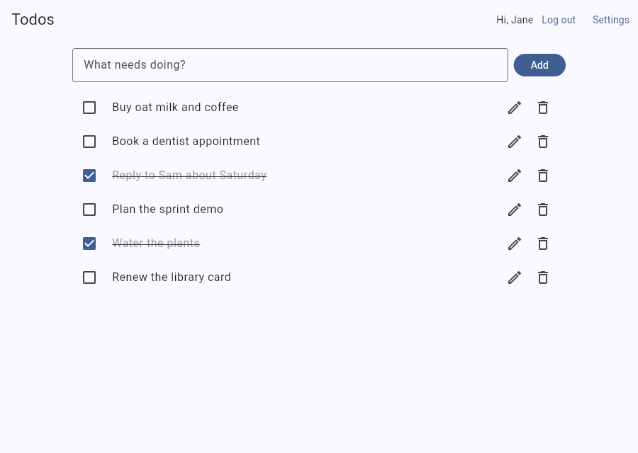

# SimpleAPI Todos API: Flutter web sample

A small Flutter web app that shows how to call the free [SimpleAPI Todos API](https://todos.simpleapi.dev/docs) from a browser, with no backend of your own.

**[Live demo](https://simple-api-dev.github.io/todos-client/)** | **[API docs](https://todos.simpleapi.dev/docs)** | **[Get a free key](https://keys.simpleapi.dev/?product=todos)**



## Run it

You need the [Flutter SDK](https://docs.flutter.dev/get-started/install) (stable; CI uses 3.47.8).

```bash
flutter pub get
flutter run -d chrome --dart-define=SIMPLEAPI_KEY=YOUR_KEY
```

Without `--dart-define`, paste your API key under Settings instead. Run the tests with `flutter test`. All HTTP is mocked, so nothing calls the real API.

## How it calls the API

Your API key goes in the `apikey` query string. A logged-in user also sends a bearer token.

```dart
final uri = Uri.https('todos.simpleapi.dev', '/api/users/$userId/todos', {'apikey': apiKey});
final response = await http.get(uri, headers: {
  'Accept': 'application/json',
  'Authorization': 'Bearer $token', // omitted for login and register
});
```

Every call lives in [`lib/todos_api.dart`](lib/todos_api.dart), one method per endpoint. The rest of the app never touches HTTP.

## Screens and API calls

| Screen | What it does | Calls |
| --- | --- | --- |
| **Todos** (`todos_screen.dart`) | Your todo list. Add, complete, edit and delete todos. Logged out, it explains the sample. | `GET /api/users/{user_id}/todos`, `POST /api/users/{user_id}/todos`, `PUT /api/users/{user_id}/todos/{id}`, `DELETE /api/users/{user_id}/todos/{id}` |
| **Log in / Register** (`auth_screen.dart`) | Get a token. **Log out** is in the app bar. | `POST /api/users/register`, `POST /api/users/login`, `POST /api/users/logout` |
| **Reset password** (`forgot_screen.dart`) | Email a 6-digit code, then send it with a new password. | `POST /api/users/forgot`, `POST /api/users/reset` |
| **Settings** (`settings_screen.dart`) | Use your own API key instead of the shared demo key. | `GET /api/todos` (one-call key check) |

`{user_id}` is always the logged-in user's own id, taken from the register or login answer. The API has more endpoints than this sample uses, such as shared todos, deleting users and admin calls. See the [full docs](https://todos.simpleapi.dev/docs).

## Keys

The live demo opens straight on the app because a shared demo key is compiled into it. To use your own, open **Settings**, paste your API key and choose **Save key**. It is checked with one call and kept only in your browser (localStorage). It is sent only to `todos.simpleapi.dev`. Get a free key at [keys.simpleapi.dev](https://keys.simpleapi.dev/?product=todos).

To set the demo key for your own deployment, add a repository **variable** named `SIMPLEAPI_KEY` (Settings, Secrets and variables, Actions, Variables) and push to `main`. The workflow builds with `--dart-define=SIMPLEAPI_KEY=...`. Anything passed this way ends up in the compiled JavaScript and can be read by anyone, so use a free key made for a public demo. With no key, the app shows a link to get one.

## Good to know

- Every error is JSON, `{"message": "..."}`. The app shows readable text for 400, 401, 403, 404, 409, 422 and 429.
- A bad or missing key answers `401`. So does a dead token; the app then logs you out and shows the login form. A failed login is also a `401` ("Invalid email or password.") and is shown on the form.
- Login and register never send the bearer token.
- A new user answers `201`. Registering an email that is already taken answers `409`.
- A key holds 25 users, and each user may have 25 todos. The call that would go over answers `403`.
- Passwords need at least 8 characters.
- The API allows 60 requests a minute per IP address. More answers `429`.
- Demo accounts are shared and public. Do not use a real password or any private details.

## Project layout

```
lib/todos_api.dart        the whole API client
lib/models.dart           Todo, AuthResult and ApiException
lib/app_state.dart        saved key and logged-in user (a ChangeNotifier)
lib/key_store*.dart       localStorage wrapper, plus an in-memory one for tests
lib/open_url*.dart        opens links in a new tab
lib/config.dart           the build-time key (SIMPLEAPI_KEY)
lib/screens/              the screens, and ui.dart with shared widgets and error wording
test/                     unit tests for the client, widget tests for the app
```

## Deploy to GitHub Pages

[`.github/workflows/pages.yml`](.github/workflows/pages.yml) runs on every push to `main`. It runs `flutter analyze` and `flutter test`, builds with `flutter build web --release --base-href /todos-client/`, and publishes with the official Pages actions. In your own copy, add the `SIMPLEAPI_KEY` variable (see Keys) and set **Settings, Pages, Source** to **GitHub Actions**. If you rename the repository, change `--base-href` to match.

## License

[MIT](LICENSE)
